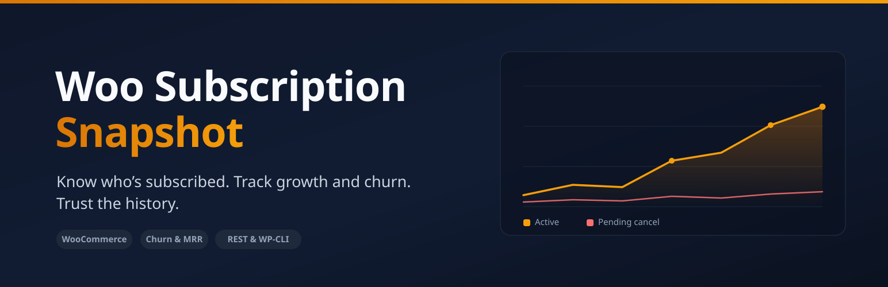

<p align="center">
  
</p>

<h1 align="center">Woo Subscription Snapshot</h1>

<p align="center">
  <strong>Know who's subscribed. Track growth and churn. Trust the history.</strong>
</p>

<p align="center">
  
  
  
  
  
</p>

<p align="center">
  <a href="#-quick-start-under-5-minutes">Quick start</a> ·
  <a href="#what-the-plugin-includes">Features</a> ·
  <a href="#settings">Settings</a> ·
  <a href="#api--cli">API</a> ·
  <a href="#roadmap">Roadmap</a> ·
  <a href="#development">Development</a>
</p>

---

## Why Woo Subscription Snapshot Exists

When a store owner asks *"how many active subscribers did we have last March?"*, most reporting tools answer with today's numbers — subscriptions that were cancelled since are silently dropped, so the past keeps getting rewritten every time a status changes.

Woo Subscription Snapshot counts subscriptions by their **activity window** (start date → next payment / end date), so a month that has already happened reflects what was actually live *then* — not what survived to now. Closed months are frozen into an immutable table, growth and churn are computed in a single pass, and the whole thing lands in your inbox on a schedule.

Works on **any** WooCommerce Subscriptions store out of the box. WooCommerce Memberships is optional — if it isn't installed, the membership column is simply hidden.

## What the Plugin Includes

### 📊 Admin dashboard
- Trend charts rendered as **inline SVG** — no external assets, no CDN, no tracking
- Month-over-month detail table with per-month active, pending cancel, new, cancelled, net change, churn % and estimated MRR
- Month-over-month deltas on the active count, and Start Date / End Date filtering for any window you care about

### 📈 Growth & churn metrics
- New subscriptions, cancellations, and net change per month
- Churn rate %, calculated against the prior month's active base
- Estimated **MRR**, normalised from each subscription's recurring total (day / week / month / year billing periods supported)

### 🗄️ Immutable monthly snapshots
- Once a month closes, its numbers are written to a custom table so later status changes **can't rewrite history**
- Reports render instantly from stored snapshots instead of recomputing the past every time
- **Backfill Monthly Snapshots** button records closed months on demand; a daily cron records each month once it closes

### ✉️ Automated email reports
- Weekly or monthly cadence, multiple recipients
- HTML summary in the body plus a **CSV attachment**
- "Send Test Email Now" button to verify delivery before you rely on it
- The CSV is written to the system temp directory and deleted right after sending — nothing is left in the public uploads folder

### 🔌 Workflow integration
- **REST API** (`GET /wp-json/wss/v1/report`) for external dashboards and Google Sheets pulls
- **WP-CLI** (`wp wss report`) for scripted exports in `table`, `csv`, or `json`
- CSV export from the admin page — nonce-protected and formula-injection safe

### 🔒 Secure & lightweight by design
- Admin-only access via the `manage_woocommerce` capability, with CSRF nonces on every action
- Single-pass queries with a 1-hour report cache — no per-subscription object loading
- HPOS (High-Performance Order Storage) compatible; degrades gracefully when Subscriptions isn't active

## 🚀 Quick Start (under 5 minutes)

1. Upload the plugin folder to `/wp-content/plugins/` (or install the ZIP from the WordPress admin).
2. Activate **Woo Subscription Snapshot** from the Plugins screen.
3. Open **Subscription Reports** in the WP admin and set your recipient email(s) and cadence.
4. *(Optional)* If you use WooCommerce Memberships, pick a plan and column label.
5. Click **Backfill Monthly Snapshots** to freeze historical months immediately — then let the weekly/monthly email do the rest.

## Settings

Found on the **Subscription Reports** admin page:

| Setting | Default | Description |
| --- | --- | --- |
| Report Recipient Email(s) | — | Where the report is sent (comma-separated for multiple) |
| Email Cadence | Monthly | Weekly or monthly |
| Membership plan | Disabled | Optional WooCommerce Memberships plan to count; only shown when Memberships is active |
| Column label | `Members` | Display name for the membership column |
| Exclude members who also hold a live subscription | On | Don't double-count subscribers in the membership column |

## API & CLI

Both are gated behind the `manage_woocommerce` capability.

```bash
# REST — external dashboards, Google Sheets, scripted pulls
GET /wp-json/wss/v1/report?start=2026-01-01&end=2026-07-31

# WP-CLI — table (default), csv, or json
wp wss report --start=2026-01-01 --end=2026-07-31 --format=table
```

## Requirements

- WordPress 5.8+, PHP 7.2+
- WooCommerce Subscriptions (active) — **required**
- WooCommerce Memberships — optional, only for the membership column
- WP Cron enabled
- Mail configuration (e.g. via SMTP) for the scheduled email

## Roadmap

- Per-product / per-plan breakdowns in the report
- Configurable MRR currency formatting and multi-currency stores
- Cohort retention view alongside the churn metric
- Downloadable PDF summary as an email attachment option

## Development

### Architecture

Everything routes through a single source of truth — `WSS_Report_Data` — which owns the queries, month bucketing, and growth/churn/MRR math. The admin page, CSV exporter, email report, and API all render the same rows, so numbers never diverge between surfaces. Closed months are served from immutable snapshots; only the current (open) month is computed live.

### Code structure

```
woo-sub-snapshot.php          Bootstrap: hooks, cron interval, HPOS compat, dependency guard
includes/
  class-wss-report-data.php   Queries, month bucketing, growth/churn/MRR (single source of truth)
  class-wss-snapshots.php     Immutable monthly snapshots (custom table + recorder cron)
  class-wss-chart.php         Inline SVG line-chart renderer
  class-wss-admin-page.php    Menu, settings, charts, report table
  class-wss-csv-exporter.php  Shared CSV writer + export handler
  class-wss-email-report.php  Scheduled email (weekly/monthly, multi-recipient, test send)
  class-wss-api.php           REST endpoint + WP-CLI command
uninstall.php                 Removes options, cron events, snapshots table, and caches
```

### Notes for maintainers

- **"Pending Cancel"** reflects the *current* subscription status, so historical months show subscriptions that are pending cancellation today.
- **Churn %** is measured against the *previous* month's active base (the first month in a range falls back to its own active count).
- **MRR** is estimated from each subscription's recurring total normalised to a monthly figure (day/week/month/year billing periods supported).
- Deactivating the plugin clears scheduled events; **uninstalling** removes all stored options, the snapshots table, and caches.
- The report cache is a 1-hour transient keyed on the date range, membership plan, and exclusion flag — status changes surface on the next cache expiry or a manual backfill.

## License

GPL-2.0-or-later.

---

<p align="center">
  
</p>

<p align="center">
  Built and maintained by <a href="https://www.nomad-developer.co.uk/">Costin Botez</a> — <a href="https://www.nomad-developer.co.uk/">Nomad Developer</a> · <a href="https://www.instagram.com/costinbotez/">@costinbotez</a><br />
  WordPress &amp; WooCommerce development for agencies and small businesses.
</p>
